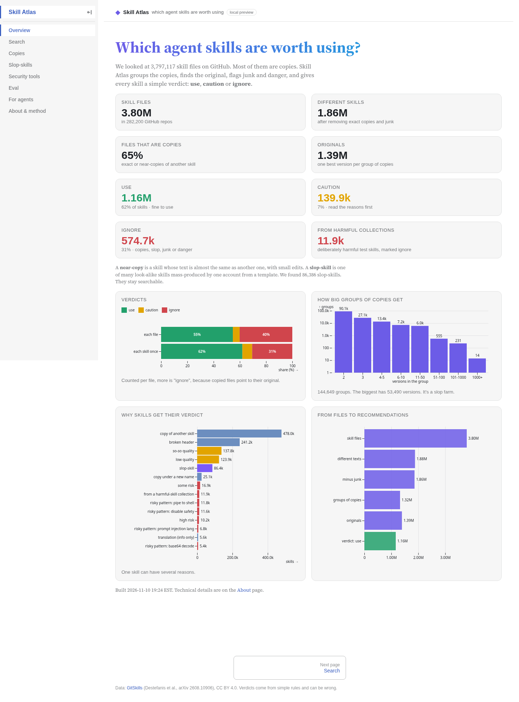
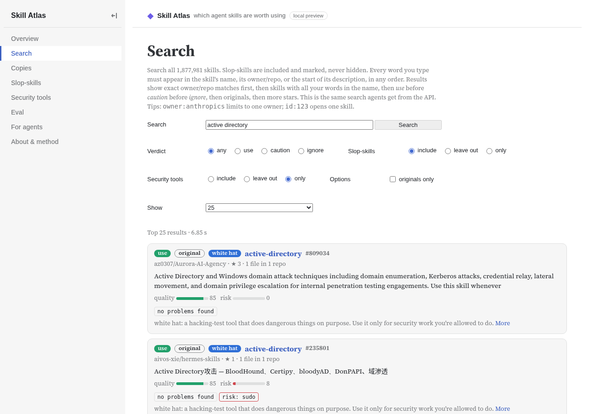

# Skill Atlas

Skill Atlas tells an AI agent which skills (`SKILL.md` files) are worth using. It looks at about 1.9 million public skills from GitHub — the [GitSkills](https://huggingface.co/datasets/mvaccargiu/gitskills) dataset ([Destefanis et al., arXiv 2608.10906](https://arxiv.org/abs/2608.10906), [CC BY 4.0](https://creativecommons.org/licenses/by/4.0/)). Each skill gets a simple verdict: **use**, **caution** or **ignore**, plus a reason.

- A **near-copy** is a skill whose text is almost the same as another skill's.
- A **slop-skill** is a skill that comes from a pile of mass-produced, near-empty skills. Slop-skills stay searchable; they are tagged, not hidden.
- **White-hat** skills are legitimate security tools (pentest, CTF, forensics, or malware analysis). They do dangerous things on purpose. Use them only for security work you're allowed to do. The tag never changes the verdict.



## Can an agent pick better skills with the atlas?

The atlas **filters out bad options**. It does not yet **find better ones**, and it is not "smarter" search.

In a test of 60 realistic agent tasks, each asking for 5 skills:

- Near-duplicate picks in an agent's top 5 drop from **26% to under 1%**, with **no loss in relevance**.
- The top 5 hold more distinct skills (3.7 without the atlas, 5.0 with it).
- After the v2 safety fixes, the atlas picked **0** skills from known harmful collections or with high risk. Plain search picked 7 of 300.
- In a blind relevance check, 93% of plain-search picks fit the task, against 94% with the atlas. The share of picks that were both a good fit and reusable (40% vs 46%) is too small a gap to be sure about.

The full write-up, including what did not work and the limitations of the test, is in [`eval/README.md`](eval/README.md). The dashboard has an [Eval](http://127.0.0.1:8770/eval) page with the same numbers.

## Try it

The hosted addresses will land here once they are up. Until then, everything runs on your own machine.

| What | Local | Hosted (coming soon) |
|---|---|---|
| Website | http://127.0.0.1:8770 | `HOSTED_DASHBOARD_URL` |
| Search API and MCP tools | http://127.0.0.1:8765 (`/skills/search`, `/mcp`) | `HOSTED_API_URL` |
| Dataset (Parquet + cards) | `out/full/` after you build it | `HOSTED_DATASET_URL` |

### Website

```bash
cd dashboard
npm install
npm run data     # needs out/full/ from the pipeline, or copy the published Parquet files
npm run build
npm run serve    # http://127.0.0.1:8770 — use http-server, not python -m http.server (Range requests required)
```

### API and MCP

```bash
# from the repo root, with out/full/verdicts_compact.parquet and out/full/search_api.parquet in place
cd server && DUCKDB_MEMORY=1GB ../.venv/bin/uvicorn app:app --host 127.0.0.1 --port 8765
# in another terminal:
.venv/bin/python server/test_mcp.py http://127.0.0.1:8765/mcp
```

Every word in a search must appear, in any order, in the skill's name, owner/repo, or the start of its description. Results prefer an exact owner/repo match, then all words in the name, then **use** before **caution** before **ignore**, then originals, then more stars. The website uses the same rules.

**HTTP API**

| Method | Path | Notes |
|---|---|---|
| GET | `/skills/search?q=&verdict=&slop=&white_hat=&limit=` | `verdict` is `use`, `caution` or `ignore`; `white_hat` is `include` (default), `exclude` or `only`; `limit` max 100 |
| GET | `/skills/{skill_id}/verdict` | one skill |
| GET | `/skills/{skill_id}/canonical` | the original version, or a note that no safe original exists |
| GET | `/stats` | headline numbers |
| GET | `/healthz` | `{"ok": true}` |

```bash
curl -s "http://127.0.0.1:8765/skills/search?q=terraform+module&verdict=use&limit=3"
```

**MCP tools** (streamable HTTP at `/mcp`): `search_skills`, `get_skill_verdict`, `find_canonical`. Same filters as the HTTP API.

```json
{
  "mcpServers": {
    "skill-atlas": { "url": "http://127.0.0.1:8765/mcp" }
  }
}
```

A hosted endpoint is meant to make this easier for other people and agents. The Docker Space and rate limits are prepared in `hf_publish/space_api/`; they are not live yet.

## Verdicts, slop-skills, and white-hat tags

| Verdict | Meaning |
|---|---|
| **use** | Fine to use. |
| **caution** | Read the reasons first (medium risk or rough quality). |
| **ignore** | A copy, slop-skill, junk, or danger. Don't install this one. If it's a copy, follow `canonical_id` to the original. |

Slop-skills are included in search and marked, never hidden. Stats are shown with and without them.

White-hat skills (13,981 of them, in about 1,900 repos) get a `white_hat` flag, a `white_hat_kind` of `offensive` or `forensics`, and `category: "white_hat_security"`. In a hand check of 40 tagged skills, 36 were real security tools, 2 were wrong and 2 were unclear. Filter them with `white_hat=include|exclude|only`.

Skills from known harmful collections (security benchmarks that ship booby-trapped skills, and close copies of the harmful part) are marked **ignore** with the reason `known_malicious_source`. They are never chosen as the original. Real security toolkits, including AeonDave/malskill, are not on that list; they are tagged white-hat instead.



## Data, attribution, and license

- **Code** in this repository is [MIT](LICENSE).
- **The skill snapshot** is [GitSkills](https://huggingface.co/datasets/mvaccargiu/gitskills) by Destefanis, Graziotin, Vaccargiu and Ortu, [arXiv 2608.10906](https://arxiv.org/abs/2608.10906), shared under [CC BY 4.0](https://creativecommons.org/licenses/by/4.0/). Please credit them if you use this project or the derived files.
- **Derived data** (verdicts, clusters, scores, search indexes) is also CC BY 4.0, as a work based on GitSkills. The same attribution applies.
- **Skill contents** remain under each file's own license. Many GitHub repos declare none. This project links out to GitHub rather than re-hosting full skill bodies.

## How to reproduce

You need Python 3.11+, a few GB of RAM for the API, and much more (a GPU is nice, not required) to rebuild the embeddings from scratch. A full pipeline run starts from the GitSkills files on Hugging Face and writes `out/full/`. The short path if you only want the site or API is to use the published Parquet files once they are up (`HOSTED_DATASET_URL`).

```bash
# 1. pipeline (full rebuild — details and every flag in docs/pipeline.md)
. .venv/bin/activate
# download GitSkills, then:
python ingest.py && python export_text.py
# embeddings and MinHash, then cluster, slop, scores, verdicts, white-hat, search index
python server/build_search.py

# 2. eval (needs the API running with DUCKDB_MEMORY=1GB for the A3 arm)
cd eval && ../.venv/bin/python run_eval.py && ../.venv/bin/python analyze.py && ../.venv/bin/python safety.py

# 3. dashboard
cd dashboard && npm run data && npm run build && npm run serve
```

The v2 safety and search fixes, and how they changed the numbers, are described in [`docs/pipeline.md`](docs/pipeline.md) and [`eval/README.md`](eval/README.md).

### What the atlas does not do yet

- It can't tell when a skill only works in one project. That was the most common problem in the blind check.
- It doesn't rank by how well a skill fits the task. It only removes copies, slop and danger from what search already found.
- Risk flags outside known harmful collections are rough. Of 370 skills newly marked high-risk, 289 were in those collections. In a hand review of 30 of the other 81, only 3 really sent secrets or keys to an unvetted host; the rest were mostly offensive-security notes, a hard-coded server IP, or a pattern mistake.

## What's in this repo

- `dashboard/` — the website (Overview, Search, Copies, Slop-skills, Security tools, Eval, For agents, About).
- `server/` — the JSON API and MCP tools.
- `eval/` — the 60-task test and the write-up of the results.
- `hf_publish/` — cards, a Docker Space, a static Space and `publish.sh` for Hugging Face. Nothing is uploaded until you run that script with a token.
- Root `*.py` — the pipeline that builds `out/full/`.
- `docs/pipeline.md` — the technical build log.

## Citation

Please cite GitSkills, and this project if you use the verdicts or the eval:

    Destefanis et al., GitSkills, arXiv 2608.10906.
    Skill Atlas, https://github.com/0xQuez/skill-atlas
